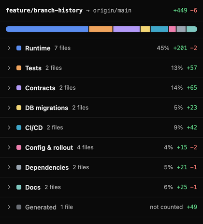

# Diff Breakdown

An [Orca](https://github.com/stablyai/orca) sidebar panel that sorts a branch's changes by kind, so
you can tell at a glance whether it's mostly code, mostly tests, or hiding a migration.

<p>
  
  
</p>

Kinds: Runtime, Tests, Contracts, DB migrations, CI/CD, Config & rollout, Dependencies and Docs.
Generated files are listed but not counted.

It compares everything in the working tree (committed, staged, unstaged and untracked) with the
branch's base: `origin/HEAD`, else `origin/main`, `origin/master`, `main` or `master`.

## Install

```sh
orca plugin install adamthewilliam/orca-diff-breakdown
```

Orca lists what the plugin can access and prints the same command with `--approve <fingerprint>`.
Run that, then open **Diff Breakdown** in the right sidebar.

It reads which workspace is focused, runs read-only `git` in it, and opens a file in Orca's editor
when you click it.

## Customise

### Settings

In Settings → Plugins → Diff Breakdown:

- `Compare against`: the base ref, such as `origin/develop`. Empty picks one as above.
- `Auto refresh (seconds)`: 10 by default. 0 refreshes only when you switch workspace or
  return to the panel.

### Categories

Add `.orca/diff-breakdown.json` at the repo root. Contracts are the usual thing to set:

```json
{
  "rules": [
    { "category": "contracts", "paths": ["crates/domain/**", "packages/api-types/**"] },
    { "category": "tests", "paths": ["apps/desktop/src/**/*_tests.rs"] }
  ]
}
```

- `category`: `runtime`, `tests`, `contracts`, `migrations`, `cicd`, `config`, `dependencies`,
  `docs` or `generated`.
- `paths`: case-insensitive globs. Without a `/` a glob matches the file name in any folder
  (`*.proto`); with one it's anchored at the repo root. `**` crosses folders, `*` doesn't.
- `"presets": false` drops the built-in rules and keeps only yours.

Your rules win. Next comes `.gitattributes` (`linguist-generated` and `linguist-vendored` mean
Generated, `linguist-documentation` means Docs), then built-in presets for Rust, TypeScript/JavaScript,
Python, Go, JVM, .NET, Swift, Ruby, PHP and Elixir. Anything left over is Runtime.

## Limits

- Categories are per file, so Rust's inline `#[cfg(test)]` modules count as Runtime.
- Only local repos are read. SSH and remote Orca hosts aren't.

## Develop

No build step: Orca transpiles the TypeScript when it loads.

```sh
bun install && orca plugin types .
bun run typecheck && bun run lint && orca plugin test .
orca plugin dev watch .   # load into Orca and stream logs; Ctrl-C unloads
```
