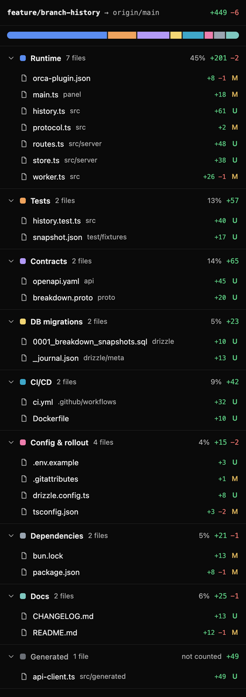

# Diff Breakdown

An [Orca](https://github.com/stablyai/orca) right-sidebar panel that breaks the focused workspace's changes down by kind, with
each group's share of the changed lines:

**Runtime · Tests · Contracts · DB migrations · CI/CD · Config & rollout · Dependencies · Docs**, plus
**Generated** (listed, not counted).

<p>
  
  
</p>

It compares the working tree (committed, staged, unstaged and untracked) against where the branch
left its base: the `Compare against` setting, else `origin/HEAD`, else `origin/main`, `origin/master`,
`main` or `master`. Orca's plugin API cannot change the built-in Source Control panel, so this is a
panel of its own.

## How files are categorised

The first match wins:

1. **Your overrides** in `.orca/diff-breakdown.json` at the repo root.
2. **`.gitattributes`**: `linguist-generated` and `linguist-vendored` → Generated,
   `linguist-documentation` → Docs.
3. **Built-in presets**: shared rules (CI/CD, Docker, docs, config files, `**/migrations/**`) plus one
   preset per ecosystem found in the repo: Rust, TypeScript/JavaScript, Python, Go, JVM, .NET, Swift,
   Ruby, PHP, Elixir. An ecosystem is found by its manifest (`Cargo.toml`, `package.json`, `go.mod`,
   ...), ignoring manifests under tests, fixtures, examples and vendored folders.
4. Anything else is **Runtime**.

Within the presets, the order is: migrations, CI/CD, dependencies, tests, contracts, config, docs.
So `migrations/0004.sql` is a migration even though `*.sql` might look like config, and `Cargo.toml`
is a dependency change rather than config.

### Overrides

Contracts are where repos differ most, so this is the usual thing to set:

```json
{
  "rules": [
    { "category": "contracts", "paths": ["crates/domain/**", "packages/api-types/**"] },
    { "category": "tests", "paths": ["apps/desktop/src/**/*_tests.rs"] }
  ]
}
```

- `category`: `runtime`, `tests`, `contracts`, `migrations`, `cicd`, `config`, `dependencies`,
  `docs` or `generated`.
- `paths`: globs, case-insensitive. A glob without `/` matches the file name in any folder
  (`*.proto`); one with `/` is anchored at the repo root (`crates/domain/**`). `**` crosses folders,
  `*` and `?` do not, `{a,b}` is either.
- `"presets": false` turns the built-in presets off, leaving only your rules and `.gitattributes`.

The panel shows which ecosystems it found and whether an overrides file is in use; a file it cannot
read is ignored and the panel says why.

### Known limits

- Rust's inline `#[cfg(test)] mod tests` blocks count as Runtime: categories are per file, not per
  hunk.
- Workspaces on SSH or remote Orca hosts are not read; the panel says so.

## Develop

No build step: Orca transpiles `src/worker.ts` and `panel/main.ts` when they load.

```sh
bun install                     # TypeScript and Node typings, for type-checking only
orca plugin types .             # writes Orca's typings to .orca/types
bun run typecheck
bun run lint
orca plugin test .              # classifier, git parsing, and the worker against a temporary repo
orca plugin validate .
orca plugin dev watch .         # load into Orca, stream logs and reloads; Ctrl-C unloads
```

Loading asks for these permissions:

- `workspace:read`: which workspace is focused and where its folder is.
- `workspace:write`: only to open a file in Orca's editor when you click it.
- `settings:own`, `storage:own`: the two settings, and which groups are open.

The worker runs `git` read-only (`diff`, `ls-files`, `check-attr`, `merge-base`, `rev-parse`) and reads
untracked files to count their lines.
